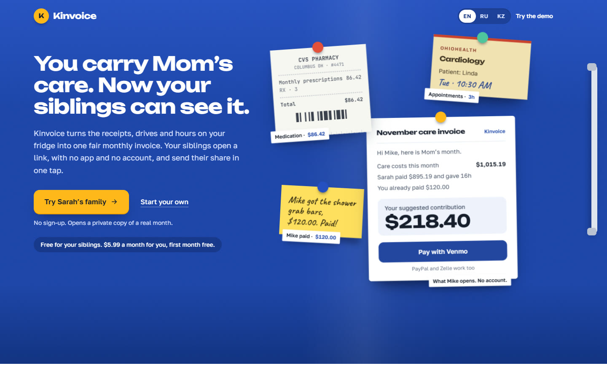
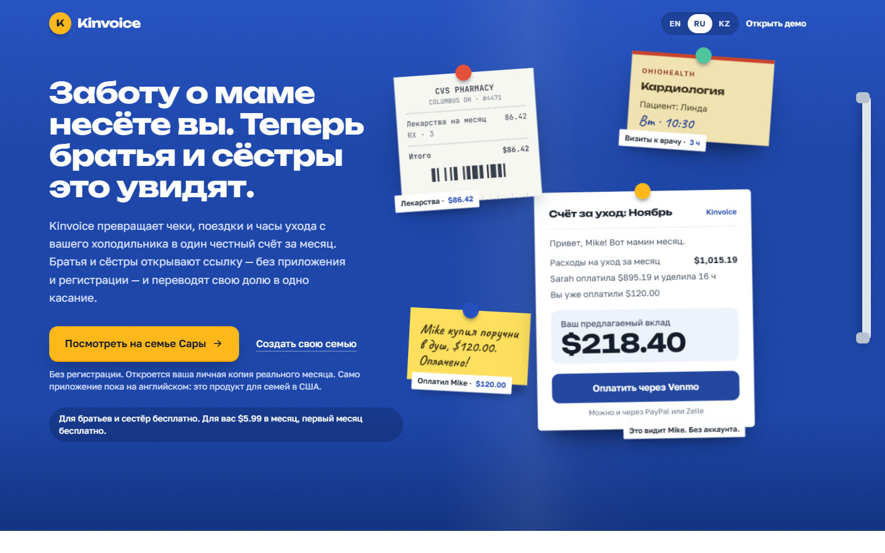
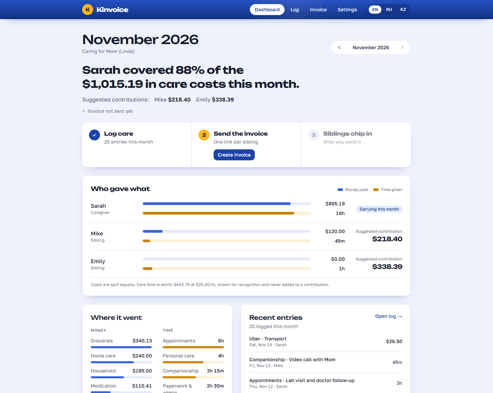
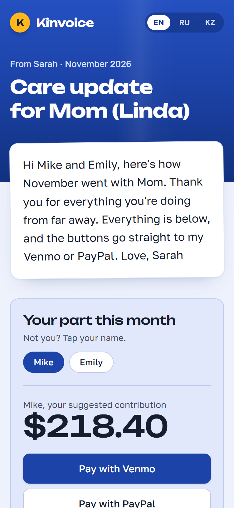

# Kinvoice

Kinvoice turns the unpaid care one sibling gives an aging parent into a clear monthly **care invoice**. Siblings open a link with no account, see what the care cost and who gave money and time, and pay their suggested contribution in one tap.

Built for Business Cup 2.0 (Nazarbayev University, Nov 14–15, 2026).

**Live:** https://kinvoice-taupe.vercel.app (click **Try Sarah's family**, no sign-up)

| Landing (EN) | Landing (RU) |
|---|---|
|  |  |

| Caregiver dashboard | What a sibling sees on the phone |
|---|---|
|  |  |

## Try it in 30 seconds

1. Open the live link and click **Try Sarah's family**. You get your own private copy of a demo family: Sarah cares for Mom, and Mike and Emily live far away.
2. **Log:** type `Paid $86 at CVS for Mom's meds, then drove her to the cardiologist, 3 hours.` The AI drafts one expense card and one time card. Check them and click **Confirm all 2**.
3. **Dashboard:** one sentence says who carried the month ("Sarah covered 88% of the care costs"), then each sibling's suggested contribution, and money and time per person on one scale.
4. **Invoice:** pick a tone; the AI drafts the update from the real numbers. Edit it, publish, and send each sibling their personal link by Text, WhatsApp or email.
5. Open Mike's link in a private window, as he would: no account, his amount is already selected. **Pay with Venmo** or PayPal, then tap **I've sent it**.
6. Back as Sarah: **Mark as received**. The dashboard now says everyone is settled.

Switch **EN / RU / KZ** in the header at any point: the choice follows you to the sibling page, and the AI writes in that language. Money stays in USD.

## How it works

- **Next.js 16** app: the UI and the API (route handlers) ship as one Vercel deploy, on Neon Postgres.
- **No login.** Caregivers hold an unguessable edit key; each sibling gets a read-only invoice link.
- **AI drafts, code decides.** OpenAI turns sentences and receipt photos into draft entries and words the monthly update. Every total and split comes from pure, tested functions in [`src/lib/money`](src/lib/money). Messages are checked so every dollar amount matches a computed one, and they never say "owe".
- **Nothing is saved without a click.** Every AI output is a draft the caregiver confirms or edits.
- **Graceful fallback.** If the AI is slow or down, a prefilled manual form and a template message still work.
- **Frozen invoices.** Publishing freezes the month's numbers, so later edits never change a link already sent.

More: [architecture and API](docs/ARCHITECTURE.md) · [product brief](docs/kinvoice-brief.md) · [design system](DESIGN.md) · [who owns what](docs/ROLES.md)

## Quality and safety

- **Tests:** 195 Vitest tests, run in CI with lint, typecheck and a production build on every PR. They cover the money math, every API route end to end (auth, validation, payment-mark rules, delete, frozen invoices), AI output validation and fallbacks, the share links in three languages, and the repository contract.
- **Privacy:** no accounts and no medical records, only amounts, categories and short neutral notes. The server stores only a SHA-256 hash of each edit key. Deleting a family removes everything, and its links stop working.
- **Hardening:** every request body is validated with Zod (400 with details; unknown ids are 404). AI and sign-up endpoints are rate-limited per IP. Pages that carry secret tokens are sent with `no-store`, `noindex` and `no-referrer`. The OpenAI key exists only on the server.

## Run locally

```bash
npm install
cp .env.example .env.local   # empty values = mock AI + in-memory store
npm run dev                  # http://localhost:3000
```

| Command | What it does |
|---|---|
| `npm run dev` | Dev server |
| `npm test` | Unit and API tests (Vitest) |
| `npm run check` | Lint + typecheck + tests (run before every commit) |
| `npm run build` | Production build (applies migrations first when `DATABASE_URL` is set) |
| `npm run db:generate` | Create a SQL migration in `drizzle/` after editing `src/server/db/schema.ts` |
| `npm run db:migrate` | Apply migrations to `DATABASE_URL` |

The repository contract tests also run against Postgres when `TEST_DATABASE_URL` points at a **disposable** Neon branch (never production): `TEST_DATABASE_URL=… npm test`.

## Team

Nurali, Olzhas, Yernur. Who owns what: [docs/ROLES.md](docs/ROLES.md).
