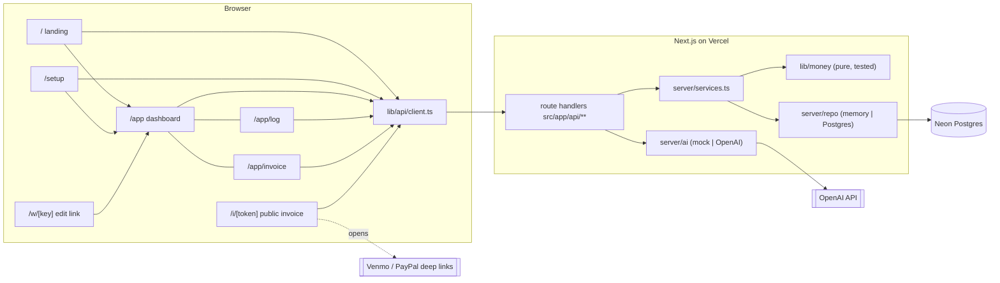

# Kinvoice architecture

## 1. Stack and why

**Next.js 16 (App Router) + TypeScript, Zod, Drizzle + Neon Postgres, OpenAI SDK, Vitest, Tailwind 4. One repo, one Vercel deploy.**

- One language and one framework for UI and API: route handlers in `src/app/api/**` are the backend, so there is no second service to deploy or keep in sync.
- Vercel deploys on every push to `main`. Neon is serverless Postgres with a free tier and a Vercel integration, so there's nothing to run.
- Zod schemas in `src/shared/` are the single contract: they type the client, validate API input, and validate AI output.
- Repository pattern: an in-memory store works from minute one (no DB needed to build UI); Postgres slots in behind the same interface.

## 2. Components

## 3. Data model

Defined in `src/shared/domain.ts` (types) and `src/server/db/schema.ts` (tables). Money = integer cents. Time = integer minutes.

| Table | Fields |
|---|---|
| `workspaces` | `id uuid`, `edit_key_hash text unique`, `parent_name text`, `hourly_rate_cents int`, `currency 'USD'`, `caregiver_handles jsonb {venmo?, paypal?, zelle?}`, `is_demo bool`, `created_at` |
| `members` | `id uuid`, `workspace_id → workspaces`, `name`, `role 'caregiver'\|'sibling'`, `email?`, `position int` |
| `entries` | `id uuid`, `workspace_id`, `member_id` (who paid / gave time), `kind 'expense'\|'time'`, `date date`, `amount_cents int?` (expense), `minutes int?` (time), `category`, `merchant?`, `note`, `source 'manual'\|'quick_log'\|'receipt'`, `created_at` |
| `invoices` | `id uuid`, `workspace_id`, `month 'YYYY-MM'`, `public_token text unique`, `tone 'warm'\|'brief'\|'direct'`, `message text`, `snapshot jsonb MonthlyBalance`, `published_at` |
| `payment_marks` | `id uuid`, `invoice_id`, `member_id`, `amount_cents`, `method 'venmo'\|'paypal'\|'zelle'\|'other'`, `status 'sent'\|'received'`, `updated_at`; unique `(invoice_id, member_id)` |

The parent is a field on the workspace (`parent_name`): one workspace = one parent, so a separate table would add a join and no value. Everything cascades from `workspaces`, so "delete workspace" removes all data.

Categories: expense `medication, medical, groceries, transport, household, home_care, insurance, other`; time `appointments, errands, personal_care, companionship, household, admin, other`.

### No-login model
- **Edit key**: 192-bit random token, created with the workspace and returned once. The browser keeps it in `localStorage`, and the caregiver bookmarks `/w/<key>` to get back in from another device. The server stores only `sha256(key)`. Every caregiver request sends `x-workspace-key`.
- **Invoice token**: a separate 192-bit random token per published invoice. `/i/<token>` is read-only, and siblings need no account. Owning a token gives no access to the workspace.
- **Demo**: `POST /api/demo` creates a **fresh private copy** of Sarah's family on every click, so jury members never see each other's edits, and "reset" just means clicking it again.
- The invoice **snapshot** freezes the balance at publish time. Later entry edits don't silently change a link that has already been sent.

## 4. API contract

Source of truth: `src/shared/api.ts`. Client: `src/lib/api/client.ts`.
Success → `{ "data": T }`. Error → `{ "error": { "code", "message", "details"? } }` with codes `bad_request 400`, `unauthorized 401`, `not_found 404`, `payload_too_large 413`, `rate_limited 429`, `internal 500`. Zod failures return 400 with `details` = `z.treeifyError`.

| Method | Path | Auth | Request | Response `data` |
|---|---|---|---|---|
| POST | `/api/workspaces` | – | `{ parentName, caregiverName, siblings:[{name,email?}], hourlyRateCents, caregiverHandles }` | `{ editKey, view: WorkspaceView }` |
| POST | `/api/demo` | – | – | `{ editKey, view }` |
| GET | `/api/workspace` | key | – | `WorkspaceView { workspace, members[] }` |
| PATCH | `/api/workspace` | key | `{ parentName?, hourlyRateCents?, caregiverHandles? }` | `WorkspaceView` |
| DELETE | `/api/workspace` | key | – | `{ deleted: true }` |
| GET | `/api/entries?month=YYYY-MM` | key | – | `Entry[]` (date desc) |
| POST | `/api/entries` | key | `{ entries: NewEntry[] }` (1–20) | `Entry[]` |
| PATCH | `/api/entries/:id` | key | `NewEntry` | `Entry` |
| DELETE | `/api/entries/:id` | key | – | `{ deleted: true }` |
| GET | `/api/balance?month=YYYY-MM` | key | – | `MonthlyBalance` |
| POST | `/api/ai/quick-log` | key | `{ text, today }` | `{ drafts: DraftEntry[], fallback }` |
| POST | `/api/ai/receipt` | key | multipart `file` (jpeg/png/webp/heic/pdf ≤ 5 MB), `today` | `{ draft: DraftEntry \| null, fallback }` |
| POST | `/api/ai/invoice-message` | key | `{ month, tone }` | `{ message, fallback }` |
| GET | `/api/invoices` | key | – | `Invoice[]` |
| POST | `/api/invoices` | key | `{ month, tone, message }` | `Invoice` (with `publicToken`, `snapshot`) |
| POST | `/api/invoices/:id/payments` | key | `{ memberId, amountCents, method }` | `PaymentMark` status `received` |
| GET | `/api/public/invoices/:token` | token | – | `PublicInvoice` |
| POST | `/api/public/invoices/:token/payments` | token | `{ memberId, amountCents, method }` | `PaymentMark` status `sent` (never downgrades `received`) |

`NewEntry` is `{ kind:'expense', date, memberId, amountCents, category, merchant?, note, source }` or `{ kind:'time', date, memberId, minutes, category, note, source }`.

## 5. AI module (`src/server/ai/`)

The interface is in `types.ts` (frozen). `index.ts#getAiService()` returns `mock.ts` when `OPENAI_API_KEY` is empty or `AI_MOCK=1`, and `openai.ts` otherwise. `config.ts` is the only reader of AI env vars. **The service never throws.** Every result carries `fallback: boolean`.

| Function | Input | Output schema | Prompt gist | Fallback |
|---|---|---|---|---|
| `parseQuickLog` | `text`, `today`, `members` | `{ drafts: DraftEntry[] }` | "Extract care expenses and time entries from the caregiver's sentence. Amounts in integer cents, durations in minutes, dates as YYYY-MM-DD relative to `today`, categories only from the enums, memberId only from the list (omit if unsure). Don't invent amounts." | Invalid JSON / timeout → `fallback:true` with any Zod-valid drafts salvaged. UI opens the manual form prefilled |
| `extractReceipt` | image/PDF bytes, `today` | `{ draft: DraftEntry \| null }` | "Read this receipt: total paid (cents), merchant, date, best expense category." | `draft:null, fallback:true` → empty manual form |
| `draftInvoiceMessage` | `tone`, names, computed `MonthlyBalance` | `{ message: string }` | "Write a short (≤120 words) family update in a {warm\|brief\|direct} tone. Use ONLY the numbers given, formatted as provided. Say 'suggested contribution', never 'owe'." | Deterministic `template.ts` text, `fallback:true` |

The implementation uses OpenAI structured outputs (JSON schema) and validates again with Zod (`DraftEntry`). There's a 12 s `AbortSignal` timeout, no retries during a request, and errors are logged server-side without user text. The AI never sees or returns balances it computed itself: the numbers come in from `lib/money`.

## 6. Money math (`src/lib/money/`)

Pure functions with no I/O and integer cents only:
- `splitEqually(total, n)` splits into shares that sum exactly to the total. Leftover cents go to the first shares, and the caregiver is ordered first, so siblings are never rounded up.
- `computeMonthlyBalance({ month, members, entries, hourlyRateCents })` filters entries to the month and computes per-member `paidCents`, `minutes`, `timeValueCents` (informational, **not** in the split) and `fairShareCents = splitEqually(totalOutOfPocket, members)`. It then sets `suggestedContributionCents = sibling ? max(0, fairShare − paid) : 0`, and adds category breakdowns.
- `formatCents`, `parseDollarsToCents`, `formatMinutes`, `timeValueCents`.

Tests: `money.test.ts` (Vitest).

## 7. Demo seed (`src/server/seed/demo-family.ts`)

Sarah (caregiver, Columbus), Mike (Denver) and Emily (Atlanta) care for Mom (Linda), with time valued at $25/h. The seed has 12 expenses (meds, copays, groceries, a home aide, gas, Uber, a handyman) and 8 time entries. Sarah pays $895.19 of $1,015.19. Mike paid $120 for grab bars and made one 45-minute video call. Emily gave one hour on Medicare paperwork. Dates are spread across the current month up to today.
